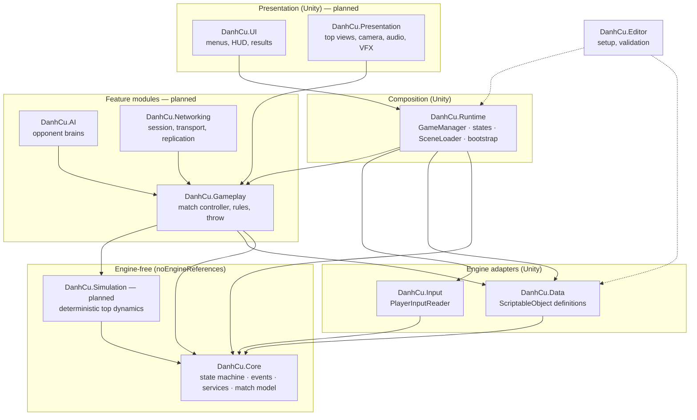
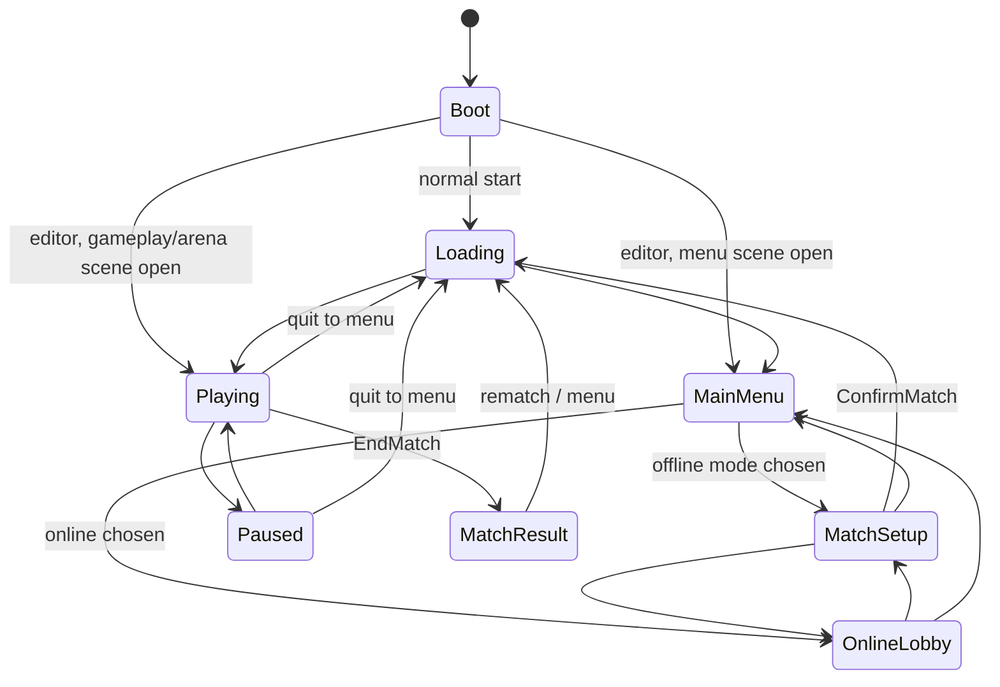

# Đánh Cù Việt Nam — Technical Design

| | |
|---|---|
| Status | Foundation (Phase 0) |
| Engine | Unity 6.3 LTS (`6000.3.x`), Universal Render Pipeline 17.3, Input System 1.14 |
| Language | C# 9 (Unity's compiler level), .NET Standard 2.1 API surface |
| Platforms | Windows, macOS, Android, iOS. Web (WebGPU/WebGL) is a design constraint, not yet a target |
| Related | [SRS](SRS.md) · [GDD](GDD.md) · [PHYSICS_SPEC](PHYSICS_SPEC.md) · [TEST_PLAN](TEST_PLAN.md) |

---

## 1. Architecture overview

The game is layered so that the parts that must be correct, testable and
shareable with a future headless server (rules, game flow, the top
simulation) have **no dependency on UnityEngine**. Unity-facing code sits on
top as a thin adaptation layer.



ASCII version (same content):

```
 ┌──────────────────────── Presentation (planned) ─────────────────────────┐
 │   DanhCu.UI (menus/HUD)            DanhCu.Presentation (views/cam/VFX)  │
 └───────────────┬───────────────────────────────────┬──────────────────────┘
                 ▼                                   ▼
 ┌──────── DanhCu.Runtime ────────┐    ┌──── Feature modules (planned) ────┐
 │ GameManager (composition root) │───▶│ Gameplay ◀── AI    Networking ──▶ │
 │ GameStates · SceneLoader       │    │    │ (match rules, throw model)   │
 │ GameBootstrapper               │    └────┼──────────────────────────────┘
 └──┬───────────┬─────────────────┘         ▼
    ▼           ▼                    ┌─ DanhCu.Simulation (planned, pure) ─┐
 DanhCu.Input  DanhCu.Data ─────────▶│ deterministic top dynamics          │
 (Input Sys)   (ScriptableObjects)   └──────────────┬──────────────────────┘
    │           │                                   ▼
    └───────────┴──────────────▶ DanhCu.Core (pure C#, no UnityEngine) ◀──┘
                                 StateMachine · GameStateMachine · EventBus
                                 ServiceRegistry · MatchSettings · Log
 DanhCu.Editor (editor only) ──▶ setup, data validation
```

**Dependency rule:** arrows point *down* only. A lower layer never references a
higher one; cross-module communication goes through Core interfaces or the
`EventBus`. Unity enforces this through assembly definitions: an illegal
reference is a compile error, not a code-review comment.

## 2. Assemblies

| Assembly | Status | Engine refs | References | Purpose |
|---|---|---|---|---|
| `DanhCu.Core` | ✅ | **none** (`noEngineReferences`) | — | Generic FSM, game-flow FSM + transition table, `EventBus`, `ServiceRegistry`, match model (`MatchSettings`, `GameSession`, `MatchResult`, `GameModeRules`), `Log` facade, **top geometry** (`Core.Tops`: shape parameters/presets, analytic profile, lathe mesh builder, mass-property integrator) |
| `DanhCu.Data` | ✅ | UnityEngine, Input System | Core | ScriptableObject definitions and validation |
| `DanhCu.Input` | ✅ | UnityEngine, Input System | Core | `PlayerInputReader`, action name constants |
| `DanhCu.Runtime` | ✅ | UnityEngine | Core, Data, Input | `GameManager`, concrete game states, `SceneLoader`, `GameBootstrapper`, engine settings |
| `DanhCu.Tops` | ✅ | UnityEngine | Core, Data | `TopModelController` (meshes, materials, colliders, Rigidbody mass properties of a top model), `TopMeshUtility` |
| `DanhCu.Editor` | ✅ | UnityEditor, URP, uGUI | all above | Idempotent project setup, default content, top mesh baking + TopModel prefab, TopData inspector, data validation menu |
| `DanhCu.Tests.EditMode` | ✅ | Test Runner | Core, Data, Editor | Unit + data tests |
| `DanhCu.Tests.PlayMode` | ✅ | Test Runner | Core, Data, Runtime | Flow smoke tests |
| `DanhCu.Simulation` | Phase 1 | **none** | Core | Top dynamics, contacts, launch model (PHYSICS_SPEC) |
| `DanhCu.Gameplay` | Phase 2 | UnityEngine | Core, Data, Simulation, Input | Match controller, rulesets, throw interaction, top views |
| `DanhCu.AI` | Phase 3 | none or UnityEngine | Core, Simulation, Gameplay contracts | AI throw planner using `AIDifficultyProfile` |
| `DanhCu.UI` | Phase 2 | UnityEngine, UI Toolkit/uGUI | Core, Data, Runtime | Menus, HUD, results, settings |
| `DanhCu.Networking` | Phase 5 | Netcode, Transport | Core, Simulation, Gameplay contracts | Lobby, relay, server-authoritative replication |

New assemblies follow the same naming (`DanhCu.<Module>`), live in
`Assets/_Project/Scripts/<Module>/`, and are added to this table.

### External packages

| Package | Version | Why |
|---|---|---|
| `com.unity.render-pipelines.universal` | 17.3.0 | Single pipeline for desktop, mobile and Web |
| `com.unity.inputsystem` | 1.14.0 | Unified touch / mouse / gamepad; required for Web |
| `com.unity.test-framework` | 1.6.0 | EditMode / PlayMode tests |
| `com.unity.ugui` | 2.0.0 | EventSystem now; UI technology decision in Phase 2 |
| *(Phase 2)* `com.unity.cinemachine` | 3.x | Match camera |
| *(Phase 2)* `com.unity.localization` | 1.5.x | vi / en text, replaces `LocalizedText` |
| *(Phase 4)* `com.unity.addressables` | 2.x | Content streaming; small initial download (mobile/Web) |
| *(Phase 5)* `com.unity.netcode.gameobjects` + `com.unity.transport` + UGS Relay/Lobby | 2.x | Online play (see §8) |

Package versions are pinned in `Packages/manifest.json`. Do not add
packages without updating this table.

## 3. Project layout

```
Nonla.co.uk/                      (repository root — shared with the website)
├── CLAUDE.md                     project rules
├── Docs/                         SRS, GDD, TECHNICAL_DESIGN, PHYSICS_SPEC, TEST_PLAN
├── Tools/CoreTests/              .NET projects that build + test Core without Unity
├── Tools/TopModelExport/         exports top geometry to OBJ/JSON (reference renders, DCC templates)
└── DanhCuVietnam/                Unity project root (open this folder in Unity Hub)
    ├── Packages/manifest.json
    ├── ProjectSettings/          (ProjectVersion.txt committed; rest generated, then committed)
    └── Assets/_Project/
        ├── Art/ (Models, Textures, Materials, Shaders, VFX)
        ├── Audio/ (Music, SFX)
        ├── Data/ (Tops, TopShapes, TopMaterials, Arenas, GameModes, AI, Physics)   ← SO instances
        ├── Localization/
        ├── Prefabs/ (Tops, Arenas, UI)
        ├── Resources/DanhCu/GameConfig.asset                            ← only Resources asset
        ├── Scenes/ Bootstrap, MainMenu, Gameplay, Arenas/Arena_SanDinh
        ├── Scripts/ Core, Data, Input, Tops, Runtime, Editor            ← one folder per assembly
        ├── Settings/ Rendering (URP assets), Input (.inputactions)
        ├── Tests/ EditMode, PlayMode
        └── UI/
```

Everything we author lives under `Assets/_Project/` so third-party assets
(store packages, plugins) never mix with ours.

## 4. Component responsibilities

### 4.1 Core (engine-free)

| Type | Responsibility | Does **not** |
|---|---|---|
| `StateMachine<TId>` | Enum-keyed FSM; guards transitions; queues requests made during Enter/Exit/Tick so a state is never exited while its code is on the stack; detects transition loops | Know about scenes, time or Unity |
| `GameStateMachine` | Wraps `StateMachine<GameStateId>` with `GameStateTransitions`; refuses to start unless every state has an implementation | Implement any state |
| `GameStateTransitions` | **Single source of truth** for legal top-level transitions (§5) | — |
| `EventBus` | Typed pub/sub for low-frequency events; no allocation on publish; handler exceptions isolated and logged | Carry per-frame data |
| `ServiceRegistry` | Explicit, owned registry of long-lived services (by interface) | Be static / global |
| `MatchSettings` | Serializable description of a match by content **ids**; self-validation | Hold asset references |
| `GameSession` | Mutable cross-scene state: current match (defensive copy), last result | Persist to disk (save system: Phase 2) |
| `GameModeRules` | Mode-dependent rules (`CanFreezeSimulationOnPause`, `RequiresNetwork`, …) | — |
| `Log` | Logging facade usable without UnityEngine | — |

### 4.2 Runtime (Unity)

| Type | Responsibility |
|---|---|
| `GameBootstrapper` | `[RuntimeInitializeOnLoadMethod(BeforeSceneLoad)]`: loads `GameConfig` from Resources and creates the persistent `[GameManager]` — whichever scene Play is pressed in |
| `GameManager` | Composition root; the **only** singleton. Creates services, registers states, ticks the FSM with unscaled time, exposes intent-level commands (`OpenMatchSetup`, `ConfirmMatch`, `StartMatch`, `TogglePause`, `EndMatch`, `Rematch`, `ReturnToMainMenu`, `QuitGame`). Contains no gameplay rules |
| `BootState` | Applies `PhysicsTuningProfile` + platform settings; on first tick routes by active scene (Bootstrap → load menu; menu → MainMenu; gameplay/arena → solo match in place, for fast iteration) |
| `LoadingState` | Runs the pending `SceneLoadRequest`, then enters its target; on failure falls back to the menu |
| `MainMenuState`, `MatchSetupState`, `OnlineLobbyState`, `MatchResultState` | UI-driven states; currently thin (UI arrives in Phase 2, online in Phase 5) |
| `PlayingState` | Enables gameplay input. Match logic lives in the Gameplay scene (Phase 2) and reports via `GameManager.EndMatch` |
| `PausedState` | Freezes `Time.timeScale` and audio **offline only**; online the simulation keeps running |
| `SceneLoader` | Coroutine-based async loads (Web-safe: no threads, no sync loads); primary scene `Single` + optional arena scene `Additive`, made active for its lighting; progress via `LoadingProgressEvent` |
| `EngineSettingsApplier` | Pushes data into engine globals (fixed timestep, solver iterations, **max angular speed**, frame rate, screen sleep) |

### 4.3 Data (ScriptableObjects)

| Asset | Key content |
|---|---|
| `GameConfig` (1, in Resources) | Scene names; lists of all modes/tops/arenas/AI profiles; defaults; physics profile; input asset; frame-rate targets. Builds default `MatchSettings` and validates ids |
| `TopDefinition` | Shape (`TopData`) + wood + tip label, max launch RPM, rope wraps, prefab, icon. Mass, CoM, I₃, I₁ and ω_crit are integrated from shape + wood |
| `TopData` | All model dimensions (body, metal tip, rope zone), metal density, tip friction, metal/rope render materials, baked mesh references. See [TOP_MODEL.md](TOP_MODEL.md) |
| `TopMaterialDefinition` | Wood density, restitution, friction, durability, visual material |
| `ArenaDefinition` | Scene name, surface type, tip friction, rolling resistance, restitution, unevenness, ring radius |
| `GameModeDefinition` | Mode type, default ruleset, rounds, time limit, availability |
| `AIDifficultyProfile` | Tier, aim error, power error, reaction time, aggression |
| `PhysicsTuningProfile` | Engine settings + spin-model coefficients (1:1 with PHYSICS_SPEC symbols) |

Rules: definitions are **read-only at runtime**; content is referenced
across systems, saves and the network by stable snake_case **ids**; every
definition implements `IValidatable`, and validation runs in EditMode tests
and from *Danh Cu → Setup → Validate Data*.

### 4.4 Input

`PlayerInputReader` wraps the `Gameplay` action map
(`PointerPosition`, `PointerPress`, `Aim`, `Charge`, `CameraOrbit`, `Pause`)
with Keyboard&Mouse, Touch and Gamepad schemes. Gameplay reads **intent**
from it, never devices, so AI and remote players can feed the same throw
model (§7). It operates on an instantiated copy of the asset.

### 4.5 Editor

`ProjectSetup` runs automatically on first open when anything is missing and
on demand (*Danh Cu → Setup → Run Project Setup*); batch: `-executeMethod
DanhCu.Editor.ProjectSetup.RunBatch`. It is **idempotent and
non-destructive** — it only creates what is missing:

1. Folder structure.
2. Player settings: company/product, Linear color space, app id
   `uk.co.nonla.danhcuvietnam` (only if still default), IL2CPP + ARM64 on mobile.
3. URP: `URP_HighFidelity` and `URP_Mobile` assets + renderers; assigned to
   Graphics settings and to empty quality levels (lower half → Mobile).
4. Default content: top render materials, 3 woods, 3 top shapes (Small/Medium/Large, meshes baked), `TopModel.prefab`, 3 tops, 1 arena, 3 modes, 3 AI tiers, physics profile, `GameConfig`.
5. Scenes: Bootstrap, MainMenu, Gameplay, Arenas/Arena_SanDinh; Build Settings with Bootstrap at index 0.
6. Active Input Handling → Input System (prompts for the required restart).

## 5. Game flow state machine



Scene mapping: `MainMenu`, `MatchSetup`, `OnlineLobby` share the MainMenu
scene (UI panels). `Playing`, `Paused`, `MatchResult` share Gameplay + arena.
Every scene change goes through `Loading`.

## 6. Scenes

| Scene | Contents | Loaded |
|---|---|---|
| `Bootstrap` | Camera only. The GameManager is created from code | First scene in builds |
| `MainMenu` | Menu camera, light, EventSystem; UI (Phase 2) | Single |
| `Gameplay` | Match camera, sun, EventSystem; match controller + HUD (Phase 2) | Single |
| `Arenas/Arena_*` | Environment art, ground colliders, lighting, ring | Additive over Gameplay, set active |

Splitting gameplay from environment lets artists iterate on arenas without
touching gameplay, and lets each arena own its baked lighting.

## 7. Gameplay architecture (Phase 1–3 outline)

```
 intent sources                     match                         simulation
 ─────────────                      ─────                         ──────────
 PlayerInputReader ─┐
 AI planner ────────┼─▶ IThrowIntent ─▶ ThrowModel ─▶ LaunchParams ─▶ TopSimulation (fixed step)
 Network (remote) ──┘                     (GDD §4)      (ω₀, v₀, tilt)        │
                                                                              ▼
                     RulesetEvaluator ◀─ TopState[] (spin, tilt, pos) ◀───────┘
                     (LongestSpin/Strike/RingOut)  │
                              │                    └─▶ TopView (Unity transforms, VFX, audio)
                              ▼
                     GameManager.EndMatch(MatchResult)
```

* One **throw model** for every participant: human, AI and remote players
  differ only in where the intent comes from.
* The **simulation** owns truth; views interpolate (render rate ≠ physics rate).
* Rulesets are pure functions of simulation state → unit-testable and identical on server and client.

## 8. Online multiplayer (Phase 5 plan)

* **Topology:** server-authoritative. Phase 5a: player-hosted via Unity
  Relay + Lobby (no server cost). Phase 5b: optional dedicated headless server
  (the engine-free Simulation makes this cheap).
* **Why not lockstep:** floating-point results are not bit-identical across
  x86/ARM, Mono/IL2CPP or compilers, so deterministic lockstep across
  platforms is unsafe. A match has ≤ 4 tops, so full state snapshots are tiny
  (~40 bytes/top) and can be sent at 30 Hz.
* **Latency hiding:** throws are discrete events — the client plays the
  wind-up locally, sends `ThrowIntent` with a timestamp, the server simulates;
  the client predicts its own top and reconciles. Opponent tops are
  interpolated ~100 ms behind.
* **Web:** Unity Transport supports WebSockets, so the same stack works in
  the browser.
* **Library choice** (Netcode for GameObjects vs Photon Fusion/Quantum) is
  decided at the start of Phase 5 against the spike results; Core and
  Simulation are library-agnostic.

## 9. Cross-platform & Web readiness

| Concern | Decision |
|---|---|
| Threads | No `System.Threading` in gameplay; coroutines / `Awaitable` only. Web has no threads by default |
| Loading | Always async; no `Resources` except `GameConfig`; Addressables for content (Phase 4) |
| File IO | Go through a `IPersistentStorage` service (Phase 2) — `PlayerPrefs`/IndexedDB on Web |
| Input | Input System only (legacy Input Manager disabled) |
| Rendering | URP; avoid features unsupported on WebGL2 (compute in critical paths); WebGPU is the target when stable |
| Reflection | Avoid; IL2CPP stripping. Add `link.xml` when a package needs it |
| Text | `LocalizedText` now; Unity Localization in Phase 2; Vietnamese diacritics need a font with full coverage (e.g. Be Vietnam Pro, SIL OFL) |
| Mobile | 60 FPS target, `Screen.sleepTimeout = NeverSleep` during play, IL2CPP + ARM64, Linear color |

## 10. Development plan

| Phase | Goal | Key deliverables | Exit criteria |
|---|---|---|---|
| **0 — Foundation** (this) | Project skeleton | Assemblies, FSM, GameManager, SO data, URP/Input setup, docs, tests, CI for Core | Project opens with no compile errors; EditMode + PlayMode + Core tests green |
| **1 — Physics spike** | Prove the top feels real | `DanhCu.Simulation` (PHYSICS_SPEC), one top + arena, debug launch, telemetry graphs; decide Simulation vs PhysX-hybrid (§PHYSICS_SPEC 2) | Acceptance tests in PHYSICS_SPEC §9 pass; 8 tops < 0.5 ms/step on reference phone |
| **2 — Core loop (solo)** | Playable single-player | Throw gesture (wind/aim/release), camera, HUD, LongestSpin ruleset, menus, settings, save data, localization vi/en | Internal playtest: 10 players can throw successfully within 3 attempts |
| **3 — AI competition** | Versus AI | AI planner, Strike + RingOut rulesets, rounds, results screen, 3 difficulties | Win rates vs AI: Easy ≥ 70 %, Hard ≤ 35 % for median tester |
| **4 — Content & look** | Commercial-quality realism | Realistic top models (PBR wood, iron tips, wear), 3–4 arenas (sân đình, sân gạch, ngõ làng, Tết market), lighting, audio, VFX, Addressables, LODs | Art review; perf budgets met on all device tiers |
| **5 — Online** | Online multiplayer | Lobby, relay, server-authoritative replication, reconnection, anti-cheat basics | 150 ms RTT playable; 0 desyncs in 100-match soak |
| **6 — Platform hardening** | Ship-ready | Device matrix, store compliance (privacy, age rating), crash reporting, analytics opt-in, accessibility | TEST_PLAN release gates |
| **7 — Web** | Browser build | WebGPU/WebGL build, compressed assets, WebSocket transport | Loads < 20 s on broadband; 30+ FPS on mid laptop |

## 11. Technical risks

| # | Risk | Likelihood | Impact | Mitigation |
|---|---|---|---|---|
| R1 | **PhysX not suited to spinning tops**: default max angular speed 7 rad/s (real tops 150–300), gyroscopic precession not reliably reproduced, tip contact on a single point jitters | High | High | Raise `defaultMaxAngularSpeed` (done in boot); Phase 1 spike of a dedicated top simulation (PHYSICS_SPEC §2) with PhysX hybrid as fallback |
| R2 | **Feel vs. realism**: physically correct throws may be too hard on touch screens | High | High | Throw-assist parameters in data; early playtests (Phase 2 exit criterion); assist levels per difficulty |
| R3 | **Online desync / latency** with fast collisions (strike resolves in ms) | Medium | High | Server authority + snapshot interpolation; strikes resolved only on server; no cross-platform lockstep (§8) |
| R4 | **Mobile performance & thermals** with realistic PBR + shadows | Medium | High | Two URP assets, quality tiers, small play area → short shadow distance; profile on low-end Android early (Phase 1) |
| R5 | **Package / editor version drift**: manifest versions pinned for 6000.3 may not match the installed LTS patch | Medium | Medium | Unity resolves editor-locked packages automatically; if resolution fails, use the versions the Package Manager proposes and update §2 |
| R6 | **Web build limits** (memory, no threads, WebGPU availability, download size) | Medium | Medium | §9 constraints from day one; Addressables; Web is Phase 7 |
| R7 | **Network library choice** (NGO vs Photon) affects cost and feature set | Medium | Medium | Keep Simulation/Core library-agnostic; decide with a spike at Phase 5 start |
| R8 | **Cultural authenticity** of tops, places and rules | Medium | Medium | Consult players/artisans; reference material; vi-first text review by native speakers |
| R9 | **Large binary assets** bloat the repo (shared with the website) | Medium | Medium | Git LFS rules in `.gitattributes`; consider a dedicated game repository before Phase 4 |
| R10 | **Foundation built without opening the editor** (scene/asset files are generated on first open) | Certain (now) | Low | Setup tool is idempotent; first person to open the project commits generated `.meta`, scenes, settings (CLAUDE.md §First open) |
| R11 | URP renderer created from code may lack default PostProcessData if the package path changes | Low | Low | Setup warns and names the asset to fix |
| R12 | IL2CPP code stripping removes types used by reflection / serialization | Low | Medium | Avoid reflection; `link.xml`; device smoke tests per build |
