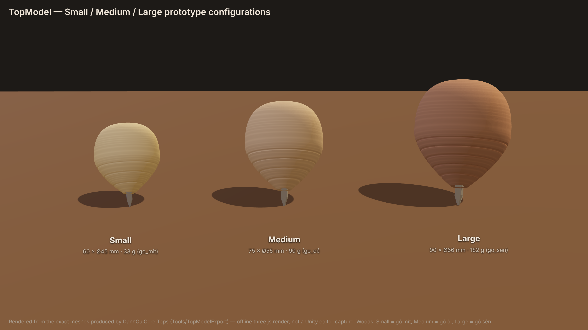
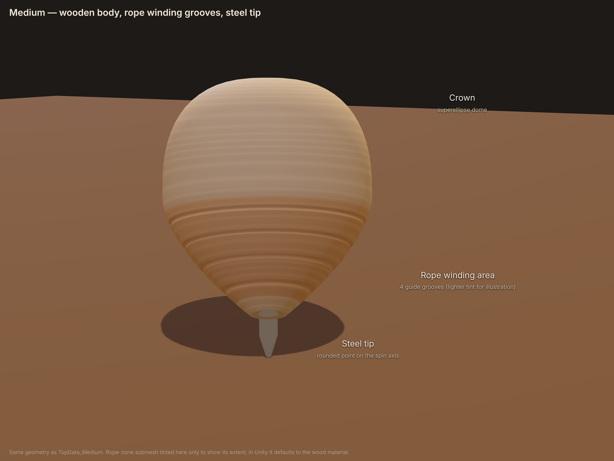
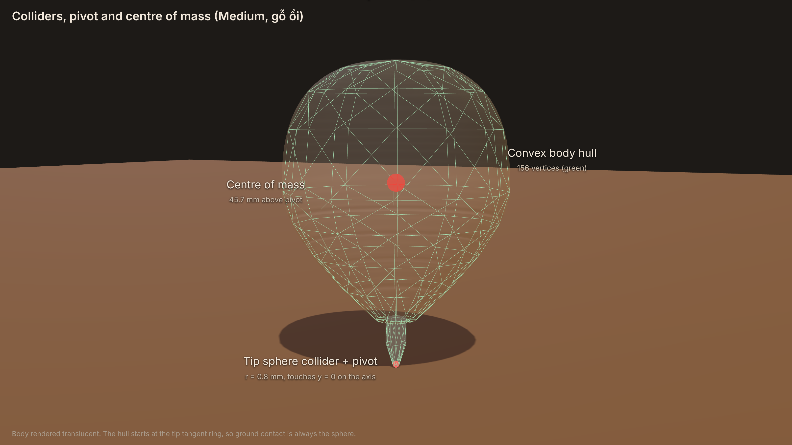
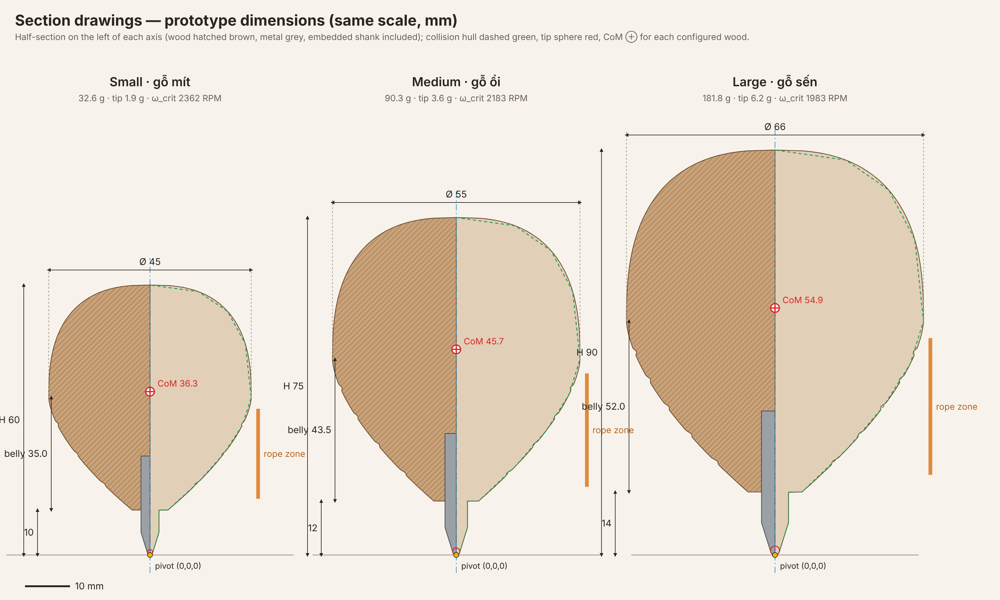

# Đánh Cù Việt Nam — Spinning Top Model

| | |
|---|---|
| Status | Prototype (Phase 1 input). All dimensions are **assumptions** (§2) |
| Code | `DanhCu.Core.Tops` (geometry, mesh, mass, engine-free) · `DanhCu.Data.TopData` (ScriptableObject) · `DanhCu.Tops.TopModelController` (Unity) · `DanhCu.Editor.TopModelAssetBuilder` (bake, prefab) |
| Assets (created by setup) | `Prefabs/Tops/TopModel.prefab` · `Data/TopShapes/TopData_{Small,Medium,Large}.asset` · `Art/Materials/Tops/M_Top_*.mat` · `Art/Models/Tops/Generated/*_Meshes.asset` |
| Related | [PHYSICS_SPEC](PHYSICS_SPEC.md) §3 · [TECHNICAL_DESIGN](TECHNICAL_DESIGN.md) |



> **About the images.** They are renders of the *exact* meshes produced by the
> project's geometry code (`Tools/TopModelExport` → OBJ → three.js in headless
> Chromium), using the same base colours and smoothness as the Unity materials.
> They are **not** Unity editor captures: no Unity editor was available when this
> was authored. Unity renders the same geometry with URP lighting.

## 1. What the model is

A procedural, rotationally symmetric top built from one analytic profile:

| Part | Geometry | Mesh / material slot |
|---|---|---|
| **Wooden body** | Flat underside ring → lower cone `r = r_c + (R − r_c)(1 − (1 − t)^p)` → superellipse crown `r = R·cos φ^(2/n)`, `y = y_b + (H − y_b)·sin φ^(2/n)` | `Body` child, submesh 0 → wood material |
| **Rope winding area** | Band of the lower cone (`RopeZoneStart`…`RopeZoneEnd`) with optional shallow `cos²` guide grooves | `Body` child, submesh 1 → rope-zone material (defaults to the wood) |
| **Metal tip** | Rounded point (sphere radius ρ) → tangent cone (half-angle α) → cylindrical shank, continuing hidden inside the wood (`TipEmbedDepth`) | `Tip` child → metal material |



Mesh budget per top (default detail): body ≈ 2.3–2.8 k vertices / 4.1–5.1 k triangles,
tip 252 v / 380 t, collision hull 156 v. One draw call per material slot (3).

### Pivot, axis and hierarchy

```
TopModel            ← origin = lowest point of the metal tip (the pivot / ground contact)
│                     +Y = spin axis; Rigidbody + TopModelController
├── Body            ← identity transform; MeshFilter, MeshRenderer [wood, rope zone], convex MeshCollider
└── Tip             ← identity transform; MeshFilter, MeshRenderer [metal], SphereCollider
```

* Every vertex is generated around the Y axis, so the tip point is exactly at
  `(0, 0, 0)` and on the axis by construction (unit-tested).
* Children are at identity: rotating the root rotates about the contact point.

### Centre of mass and inertia

Mass properties are **integrated from the geometry**, never typed in:
thin-disc slices of the revolved profile with wood density in the body and
metal density in the tip (including the embedded shank), composite 3-point
Gauss–Legendre quadrature split at every kink. The integrator reproduces the
closed-form cylinder and cone to < 10⁻⁹ (tests). The controller writes the result
to the Rigidbody explicitly:

* `mass` = wood + metal
* `centerOfMass` = `(0, l, 0)` — on the axis
* `inertiaTensor` = `(I₁_com, I₃, I₁_com)`, `inertiaTensorRotation` = identity
* `angularDamping = linearDamping = 0` (spin losses are modelled per PHYSICS_SPEC §4), `maxAngularVelocity` ≥ the project cap

### Colliders



* **Body:** convex `MeshCollider` from a low-poly hull of the outline (12 rings × 13 columns incl. UV seam, 156 vertices, under PhysX's 255-face limit). Grooves are ignored (envelope radius).
* **Tip:** `SphereCollider` with radius = `TipPointRadius`, centre `(0, ρ, 0)` → it touches `y = 0` exactly on the axis.
* The hull starts at the tangent ring of the rounded point, so it never reaches below the sphere: **ground contact is always the sphere at the pivot**.
* Physics materials (runtime only, never serialized): tip from `TopData.tipFriction/tipBounciness`; body from the wood's `bodyFriction/restitution`.

## 2. Prototype dimensions — assumptions

> These values were **chosen for prototyping**: plausible hand-sized proportions
> that make the three sizes clearly different in feel. They are **not**
> historical, traditional or measured dimensions of Vietnamese tops, and must
> not be presented as such. Replace them with measurements of real *con cù*
> (calipers + scale, several makers and regions) during Phase 1 calibration;
> only the TopData assets need to change.

| Parameter (`TopData` field) | Small | Medium | Large | Unit |
|---|---|---|---|---|
| Total height `totalHeight` | 60 | 75 | 90 | mm |
| Body diameter `bodyDiameter` | 45 | 55 | 66 | mm |
| Belly height ratio `bellyHeightRatio` | 0.50 | 0.50 | 0.50 | of wood height |
| Collar diameter `collarDiameter` | 8 | 10 | 12 | mm |
| Lower cone fullness `lowerCurveExponent` | 1.6 | 1.6 | 1.6 | – |
| Crown flatness `crownFlatness` | 2.6 | 2.6 | 2.6 | – |
| Exposed tip length `tipExposedLength` | 10 | 12 | 14 | mm |
| Shank diameter `tipShankDiameter` | 4 | 5 | 6 | mm |
| Taper length `tipConeLength` | 6.5 | 8 | 9.5 | mm |
| Point radius `tipPointRadius` | 0.6 | 0.8 | 1.0 | mm |
| Embedded shank depth `tipEmbedDepth` | 12 | 15 | 18 | mm |
| Metal density `metalDensity` | 7850 | 7850 | 7850 | kg/m³ (steel) |
| Rope zone `ropeZoneStart`–`ropeZoneEnd` | 0.10–0.90 | 0.10–0.90 | 0.10–0.90 | of lower cone |
| Grooves `ropeGrooveCount` × depth × width | 3 × 0.3 × 1.4 | 4 × 0.4 × 1.6 | 5 × 0.5 × 1.8 | mm |

Wood densities (`TopMaterialDefinition`, also assumptions): gỗ mít 600, gỗ ổi
900, gỗ sến 1050 kg/m³. Render colours are neutral placeholders, not colour-matched woods.

### Resulting mass properties (computed, not assumed)

| Size · wood (default pairing) | Mass | Tip mass | CoM above pivot | I₃ (kg·m²) | I₁ at CoM (kg·m²) | ω_crit | Max launch (TopDefinition) |
|---|---|---|---|---|---|---|---|
| Small · gỗ mít (`cu_go_mit`) | 32.6 g | 1.9 g | 36.3 mm | 6.21e-6 | 7.94e-6 | 2362 RPM | 3000 RPM (1.27×) |
| Medium · gỗ ổi (`cu_go_oi`) | 90.3 g | 3.6 g | 45.7 mm | 2.62e-5 | 3.31e-5 | 2183 RPM | 2800 RPM (1.28×) |
| Large · gỗ sến (`cu_go_sen`) | 181.8 g | 6.2 g | 54.9 mm | 7.64e-5 | 9.56e-5 | 1983 RPM | 2600 RPM (1.31×) |

Full table for every size × wood: run the exporter (§4) and open `summary.md`.
Validation requires max launch ≥ 1.2 × ω_crit (PHYSICS_SPEC §4.2).



## 3. How to change dimensions

### In the Unity editor (designers)

1. Select a shape asset in `Assets/_Project/Data/TopShapes/` (e.g. `TopData_Medium`).
2. Edit fields in the Inspector. All lengths are **metres** (SI rule); the
   *Derived* panel below the fields shows them in mm together with mass,
   centre of mass, inertia and critical spin for a preview wood density.
3. Meshes **re-bake automatically** when you change a value (or press
   *Rebake meshes*). Every `TopModel` instance that uses this shape updates.
4. Invalid combinations are shown as errors in the inspector and are refused
   at runtime (e.g. collar narrower than the shank, point radius too large for the taper).
5. *Reset dimensions to preset* → Small / Medium / Large restores the defaults above.

To make a **new size**: *Create → Danh Cu → Top Data (Shape)*, give it a
snake_case id, set the dimensions and metal material, then reference it from a
`TopDefinition` (`shape` field). Re-check the definition's max launch RPM
(validation will tell you if it is below 1.2 × ω_crit).

### On a model instance

`TopModelController` → assign `Shape` (TopData) and `Wood`
(TopMaterialDefinition). At runtime call `controller.Configure(topDefinition)`
or `controller.Apply(shape, wood)`; in play mode, shapes without a current bake
are generated on the fly.

### In code / presets

`DanhCu.Core.Tops.TopShapePresets` holds the three defaults (used by setup, tests
and the exporter). Changing a preset does **not** modify existing assets; use
the inspector preset buttons or edit the asset.

### Menus

* *Danh Cu → Tops → Rebake All Top Meshes*
* *Danh Cu → Tops → Rebuild TopModel Prefab* (asks before replacing)
* *Danh Cu → Setup → Run Project Setup* creates everything that is missing.

## 4. Exporting the geometry

```bash
dotnet run --project Tools/TopModelExport -- out/
```

Writes, per size: `top_<size>_body.obj` (groups `wood`, `rope_zone`),
`top_<size>_tip.obj`, `top_<size>_collision.obj` (metres, Y-up, right-handed —
X mirrored, as Blender and Unity's OBJ importer expect), `top_<size>.json`
(parameters, key heights, sampled outlines, mass properties for each wood) and
`summary.md`. Artists can use the OBJ as an exact template when sculpting a
high-detail version; keep the pivot at the tip point and the axis on +Y.

## 5. Known limitations

* Rotationally symmetric only: no carved decorations, knobs or asymmetry. A
  sculpted mesh can replace the `Body` mesh later; mass properties still come
  from the profile, so keep the outline matched.
* Wood is treated as homogeneous; real tops vary in density and grain.
* The `TipType` on `TopDefinition` is a label; the tip shape is defined by the TopData.
* Wood grain textures are not authored yet (UVs are cylindrical: u around the
  axis, v along the profile, ready for a turned-wood texture).
